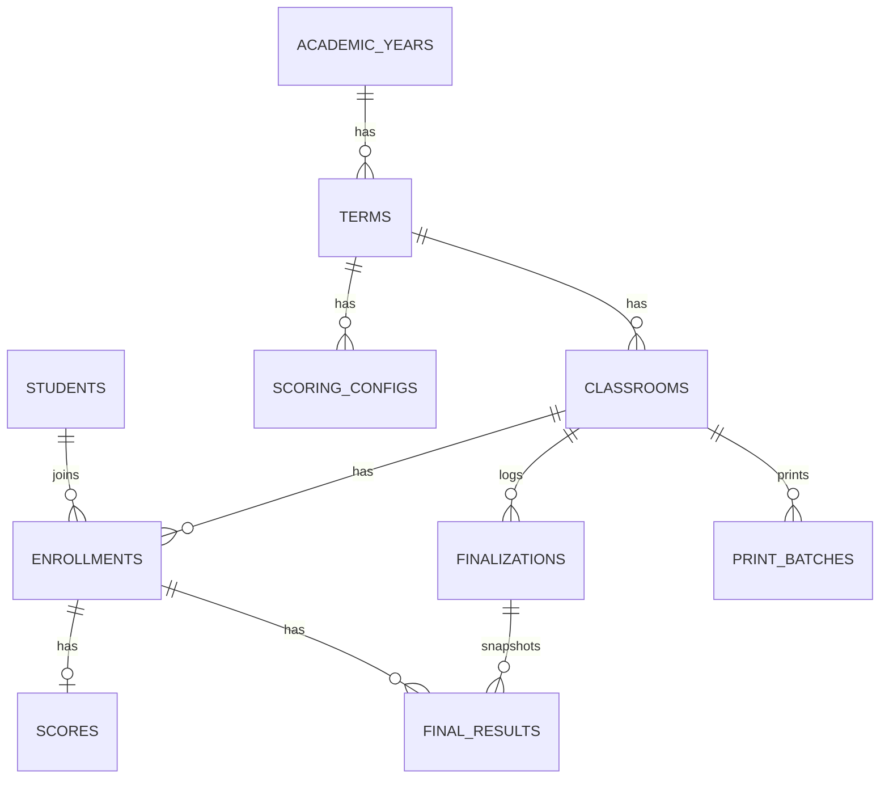

# PRD-01 — Arsitektur & Teknologi

## 1. Prinsip arsitektur

1. **Monolit sederhana**: satu aplikasi Laravel yang merender halaman Vue lewat **Inertia.js** — tanpa API publik terpisah, tanpa SPA terpisah. Lebih mudah dideploy ke shared hosting.
2. **Satu sumber kebenaran untuk perhitungan**: kalkulator CEFR di PHP (`CefrCalculator`) adalah otoritas. Versi TypeScript yang identik dipakai di browser **hanya untuk umpan balik instan**; hasil yang disimpan/dicetak selalu dari server. Keduanya diuji dengan **fixture JSON yang sama**.
3. **Ramah shared hosting**: tidak butuh Node.js di server, tidak butuh queue worker, tidak butuh Chrome/headless browser. Pekerjaan berat (cetak massal) dipecah per permintaan HTTP.
4. **Snapshot saat finalisasi**: data historis tidak berubah ketika pengaturan diubah di kemudian hari.
5. **Gagal dengan anggun**: setiap aksi punya state loading/sukses/gagal; error server diterjemahkan ke pesan Bahasa Indonesia (PRD-07).

## 2. Stack teknologi

| Lapisan | Pilihan | Catatan |
|---|---|---|
| Bahasa server | PHP 8.3 (min. 8.2 di hosting) | Laragon lokal PHP 8.3 |
| Framework | **Laravel 12** | Starter kit Vue (Inertia) sebagai titik awal |
| Jembatan | **Inertia.js v2** (`inertiajs/inertia-laravel`, `@inertiajs/vue3`) | Partial reload, deferred props, prefetch |
| Frontend | **Vue 3.5 + TypeScript**, Vite 6 | Build di lokal, hasil `public/build` diunggah |
| UI kit | **shadcn-vue** (berbasis Reka UI) + **Tailwind CSS v4** | Komponen disalin ke `resources/js/components/ui` |
| Ikon | `lucide-vue-next` | |
| Notifikasi | `vue-sonner` (Toast shadcn-vue) | |
| Form & validasi klien | `vee-validate` + `zod` (`@vee-validate/zod`) | Validasi akhir tetap di server (FormRequest) |
| Utilitas | `@vueuse/core` (debounce, online status, idle) | |
| Grafik layar | `chart.js` + `vue-chartjs` | Bar, stacked bar, radar, line, doughnut |
| Drawer mobile | `vaul-vue` (komponen Drawer shadcn-vue) | Dialog jadi bottom sheet di layar < 768 px |
| Animasi | Transisi Vue + CSS (`tw-animate-css`), `@vueuse/motion` opsional | Hormati `prefers-reduced-motion` |
| PDF | **`barryvdh/laravel-dompdf`** | Tanpa Chrome; grafik radar dibuat sebagai SVG→PNG di server (lihat PRD-05) |
| Penggabungan PDF | `setasign/fpdi` | Menggabungkan PDF hasil cetak massal bertahap |
| Excel | **`maatwebsite/excel`** (PhpSpreadsheet) | Impor & ekspor `.xlsx`/`.csv` |
| Database | MySQL 8 / MariaDB 10.6+ | Lokal: MySQL Laragon |
| Sesi & cache | Driver `database` (sesi), `file`/`database` (cache & rate limiter) | Tanpa Redis |
| Pengujian | **Pest** (PHP), **Vitest** (TS) | Uji paritas kalkulator wajib |
| Kualitas kode | Laravel Pint, ESLint + Prettier, `vue-tsc` | |

## 3. Struktur folder (utama)

```
app/
  Domain/Cefr/
    CefrCalculator.php          # mesin hitung (murni, tanpa DB)
    ScoringConfig.php           # value object: max, bobot, ambang, harapan
    SkillResult.php, StudentResult.php
    Level.php (enum)            # PreA1, A1, A2, B1, B2
    Skill.php (enum)            # Listening, Reading, Writing, Speaking
  Http/
    Controllers/ (Dashboard, Score, Report, Student, Period, Classroom, Import, Document, Setting, Pin, Setup, ActivityLog)
    Middleware/ EnsurePinVerified.php, EnsureSetupComplete.php, RequireRecentPin.php, SecurityHeaders.php
    Requests/ ...               # FormRequest per aksi
  Models/ AcademicYear, Term, Classroom, Student, Enrollment, Score, ScoringConfig, Finalization, FinalResult, Descriptor, LevelMeta, Setting, ActivityLog, Document, PrintBatch
  Services/ FinalizationService, ReportDataBuilder, PdfReportService, RadarChartRenderer, BatchPrintService, ImportService, ExportService, BackupService, ActivityLogger
  Imports/ StudentsImport.php, ScoresImport.php
  Exports/ ClassScoresExport.php, TermRecapExport.php
resources/js/
  pages/        # halaman Inertia (Dashboard.vue, Scores/Index.vue, Scores/Grid.vue, ...)
  components/ui # komponen shadcn-vue
  components/app# komponen khusus (LevelBadge, ScoreCell, SaveIndicator, CefrLadder, PinPad, ...)
  composables/  # useAutosave, useCefr, useOnline, useConfirmPin
  lib/cefr.ts   # mirror kalkulator (untuk umpan balik instan)
  types/
resources/views/pdf/report.blade.php   # template rapor PDF
tests/fixtures/cefr-parity.json        # kasus uji bersama PHP & TS
```

## 4. Model data (ERD)



### 4.1 Tabel

**settings** — key/value
| Kolom | Tipe | Keterangan |
|---|---|---|
| key | string PK | `school_name` (bawaan "SD Muhammadiyah Wonorejo"), `school_address`, `program_name`, `partner_name`, `city`, `principal_name`, `principal_id_label` (bawaan `NBM`), `principal_id_number`, `school_logo_path`, `second_logo_path` (logo Muhammadiyah, opsional), `partner_logo_path` (opsional), `report_layout` (json — PRD-05 §5), `pin_hash`, `recovery_code_hash`, `active_term_id`, `session_idle_minutes`, `pin_changed_at` |
| value | text/json | |

**academic_years**: `id`, `name` (unik, format `2026/2027`), `starts_on`, `ends_on`, timestamps.

**terms** (periode): `id`, `academic_year_id` FK, `semester` (1|2), `label` (mis. "Semester 1"), `report_date` (date), `is_active` (bool, hanya satu true), timestamps. Unik (`academic_year_id`, `semester`).

**scoring_configs** (per periode × grade): `id`, `term_id` FK, `grade` (3–6), `max_listening`, `max_reading`, `max_writing`, `max_speaking` (decimal 5,1; bawaan 20), `weight_listening`…`weight_speaking` (decimal 5,2; bawaan 25), `thresholds` (json: `{"Pre-A1":0,"A1":50,"A2":80,"B1":null,"B2":null}`), `expected_min`, `expected_max` (enum level), timestamps. Unik (`term_id`,`grade`). Dibuat otomatis (salin dari periode sebelumnya atau bawaan) saat periode dibuat.

**classrooms**: `id`, `term_id` FK, `grade` (3–6), `name` (mis. "3A"), `homeroom_teacher`, `homeroom_id_number` (NBM, opsional), `english_teacher`, `english_id_number` (opsional), `status` (`draft`|`final`), `finalized_at` nullable, `current_finalization_id` nullable, timestamps. Unik (`term_id`,`name`).

**students**: `id`, `nis` (string unik), `name`, `gender` (L/P, opsional), `is_active` (bool), `notes` nullable, timestamps, soft deletes.

**enrollments**: `id`, `classroom_id` FK, `student_id` FK, `roll_no` (nomor urut di kelas), timestamps. Unik (`classroom_id`,`student_id`). Aturan: satu siswa hanya satu kelas per periode (divalidasi di service).

**scores**: `id`, `enrollment_id` FK unik, `listening`, `reading`, `writing`, `speaking` (decimal 4,1 nullable), `teacher_comment` (text nullable, maks 600 karakter), `version` (int, untuk optimistic locking), `updated_at`.

**finalizations** (riwayat kunci/buka): `id`, `classroom_id` FK, `action` (`finalize`|`unfinalize`), `reason` (text, wajib untuk unfinalize), `config_snapshot` (json: scoring config + deskriptor + teks rapor + **layout rapor** + identitas sekolah yang dipakai), `ip`, `user_agent`, `created_at`.

**final_results** (snapshot per siswa saat finalisasi): `id`, `finalization_id` FK, `enrollment_id` FK, `classroom_id`, `term_id`, `student_id`, `grade`, skor mentah ×4, persen ×4, level ×4, `overall_pct`, `overall_level`, `status`, `strongest_skill`, `comment_final` (teks komentar yang tampil di rapor), `is_current` (bool), timestamps. Indeks untuk dashboard: (`term_id`,`grade`,`overall_level`).

**descriptors**: `id`, `level`, `skill`, `can_do` (text EN), `next_step` (text EN). Unik (`level`,`skill`). 20 baris.

**level_meta**: `level` PK, `name` (mis. "Elementary (Waystage)"), `cambridge` (mis. "A2 Flyers / A2 Key"), `overall_comment` (EN), `color_hex`, `sort` (1–5).

**print_batches**: `id` (uuid), `classroom_id`, `mode` (`merged`|`zip`), `total`, `done`, `failed` (json daftar siswa gagal), `status` (`running`|`completed`|`failed`|`expired`), `file_path` nullable, `created_at`, `expires_at`.

**documents** (opsional): `id`, `title`, `grade` nullable, `category` (`tes`|`pedoman`|`lainnya`), `file_path`, `original_name`, `size`, `mime`, timestamps.

**activity_logs**: `id`, `action` (mis. `score.updated`, `class.finalized`, `pin.failed`), `subject_type`, `subject_id`, `description` (ID), `meta` (json: nilai lama/baru), `ip`, `device` (ringkasan user agent), `session_short` (6 karakter hash sesi), `created_at`. Retensi 1 tahun.

### 4.2 Seeder
- `level_meta` (5 baris), `descriptors` (20 baris) — teks dari Excel/Pedoman.
- Ambang batas & level harapan bawaan (lihat PRD-00 §7).
- Data contoh (opsional, perintah terpisah `php artisan db:seed --class=DemoSeeder`).

## 5. Rute & endpoint

Semua rute (kecuali `/pin`, `/setup`, `/pin/recover`) dilindungi middleware `pin.verified`. Aksi sensitif memakai `pin.recent` (PIN dimasukkan ≤ 5 menit terakhir; jika belum → dialog PIN di klien).

| Metode | URL | Fungsi |
|---|---|---|
| GET/POST | `/setup` | Setup awal |
| GET/POST | `/pin` | Masuk PIN |
| POST | `/pin/lock` | Kunci layar (logout sesi) |
| POST | `/pin/confirm` | Konfirmasi PIN untuk aksi sensitif |
| GET/POST | `/pin/recover` | Reset PIN dengan kode pemulihan |
| GET | `/` | Dashboard (props tertunda / deferred untuk grafik) |
| GET | `/kelas` | Semua kelas periode aktif (kartu per jenjang + progres) |
| GET | `/kelas/{classroom}` | Mengarahkan ke tab bawaan: `nilai` (Draft) atau `rapor` (Final) |
| GET | `/kelas/{classroom}/nilai` | Tab Input Nilai |
| PATCH (JSON) | `/kelas/{classroom}/skor/{enrollment}` | Autosave satu sel/komentar → kembalikan hasil hitung + `version` |
| POST | `/kelas/{classroom}/finalkan` | Finalisasi (`pin.recent`) |
| POST | `/kelas/{classroom}/batalkan-final` | Batalkan finalisasi (`pin.recent`, alasan wajib) |
| GET | `/kelas/{classroom}/rapor` | Tab Rapor & Cetak |
| GET | `/kelas/{classroom}/rapor/{enrollment}` | Pratinjau rapor (HTML) |
| GET | `/kelas/{classroom}/rapor/{enrollment}/pdf?paper=f4/a4&inline=0/1` | Unduh (`inline=0`) atau buka untuk cetak (`inline=1`) PDF satu siswa |
| POST | `/kelas/{classroom}/rapor/batch` | Mulai PDF semua/terpilih siswa → `batch_id` (body: `paper`, `mode`, `enrollment_ids`) |
| POST | `/rapor/batch/{batch}/next` | Proses potongan berikutnya → progres |
| GET | `/rapor/batch/{batch}/download?inline=0/1` | Unduh atau buka untuk cetak hasil |
| GET | `/kelas/{classroom}/riwayat` | Tab Riwayat finalisasi |
| GET/PUT | `/pengaturan/rapor` | Pengaturan layout rapor + pratinjau (`/pengaturan/rapor/preview?…` mengembalikan PDF contoh) |
| resource | `/siswa`, `/periode`, `/kelas` | CRUD |
| POST | `/impor/{type}/preview` & `/impor/{type}/commit` | Impor dua tahap |
| GET | `/ekspor/kelas/{classroom}`, `/ekspor/periode/{term}` | Ekspor xlsx |
| resource | `/dokumen` | Unggah/unduh/hapus dokumen |
| GET/PUT | `/pengaturan/*` | Pengaturan per tab |
| GET | `/pengaturan/cadangan/unduh` | Unduh cadangan (`pin.recent`) |
| GET | `/log` | Log aktivitas (filter, paginasi) |

Respons JSON error mengikuti format seragam (lihat PRD-07 §8):
```json
{ "message": "Pesan untuk pengguna", "code": "SCORE_OUT_OF_RANGE", "errors": { "listening": ["Nilai harus antara 0 dan 20."] }, "ref": "ERR-7F3K2" }
```

## 6. Keamanan (ringkas — detail PRD-02)
- HTTPS wajib di produksi (`APP_URL=https://…`, `SESSION_SECURE_COOKIE=true`).
- CSRF bawaan Laravel; cookie sesi `HttpOnly`, `SameSite=Lax`.
- Header keamanan: `X-Frame-Options: DENY`, `X-Content-Type-Options: nosniff`, `Referrer-Policy: same-origin`, CSP dasar.
- `robots.txt` → `Disallow: /`; meta `noindex`.
- Unggahan file: validasi MIME & ukuran, disimpan di `storage/app/private`, diunduh lewat controller (tidak bisa diakses langsung).
- `APP_DEBUG=false` di produksi; error dicatat ke `storage/logs` dengan kode referensi.

## 7. Kinerja

| Target | Nilai |
|---|---|
| Muat halaman (TTFB) | < 600 ms di shared hosting |
| Autosave satu sel (round-trip) | < 400 ms rata-rata |
| PDF satu siswa | < 3 detik |
| Cetak massal 40 siswa | < 2 menit, tanpa ada permintaan > 25 detik |
| Ukuran bundle JS awal | < 300 KB gzip (code splitting per halaman, Chart.js dimuat lazy) |

Teknik: eager loading untuk menghindari N+1, indeks pada FK & kolom filter, cache konfigurasi (`config:cache`, `route:cache`, `view:cache`), deferred props Inertia untuk grafik dashboard.

## 8. Deployment ke shared hosting (cPanel)

### 8.1 Persiapan di lokal (Laragon)
1. `composer install --no-dev --optimize-autoloader`
2. `npm ci && npm run build` → menghasilkan `public/build`.
3. Salin `.env.example` → `.env.production` (isi `APP_ENV=production`, `APP_DEBUG=false`, `APP_URL`, kredensial DB).
4. Kompres proyek (tanpa `node_modules`, `.git`, `tests`).

### 8.2 Di hosting
1. Buat database & user MySQL di cPanel.
2. Unggah folder aplikasi ke **di luar** `public_html` (mis. `~/icp-app`).
3. Isi `public_html` (atau subdomain) dengan isi folder `public/`; ubah `index.php` agar menunjuk ke `~/icp-app/vendor/autoload.php` dan `~/icp-app/bootstrap/app.php`. *(Alternatif bila hosting mendukung: arahkan document root subdomain langsung ke `~/icp-app/public`.)*
4. Jalankan migrasi:
   - Jika ada Terminal/SSH: `php artisan migrate --force && php artisan db:seed --force && php artisan storage:link && php artisan optimize`.
   - Jika tidak ada: buka **`/install`** (installer web sekali pakai, aktif hanya bila tabel `settings` belum ada dan `INSTALL_TOKEN` di `.env` cocok) yang menjalankan migrasi+seed, lalu menonaktifkan dirinya.
5. Atur PHP 8.2+ di "Select PHP Version"; ekstensi wajib: `pdo_mysql`, `mbstring`, `gd`, `zip`, `xml`, `fileinfo`, `intl`, `bcmath`.
6. (Opsional) Cron per menit: `php ~/icp-app/artisan schedule:run` untuk pembersihan file sementara & log lama. Tanpa cron, pembersihan dijalankan oportunistik saat login PIN (maks. sekali per jam).

### 8.3 Pembaruan versi
Build ulang di lokal → unggah file yang berubah → `/install/migrate` (dilindungi PIN + token) atau `php artisan migrate --force`.

## 9. Lingkungan

| Lingkungan | Keterangan |
|---|---|
| Lokal | Laragon (PHP 8.3, MySQL), `npm run dev` + `php artisan serve` atau virtual host Laragon `icp.test` |
| Staging (opsional) | Subdomain di hosting yang sama dengan DB terpisah |
| Produksi | Subdomain mis. `rapor.namasekolah.sch.id` |

## 10. Pengujian

| Jenis | Cakupan minimal |
|---|---|
| Unit (Pest) | `CefrCalculator` — seluruh fixture paritas; FinalizationService; ImportService (validasi baris) |
| Feature (Pest) | PIN & rate limit; autosave (versi/konflik/kelas final 423); finalisasi & pembatalan; PDF tergenerate; batch print |
| Unit (Vitest) | `lib/cefr.ts` — fixture paritas yang sama |
| Komponen (Vitest + Vue Test Utils) | ScoreCell (validasi, navigasi keyboard), PinPad |
| Manual | Cetak PDF di printer sekolah; uji di Chrome, Edge, Firefox, Safari iPad |

## 11. Kriteria penerimaan arsitektur
- [ ] Aplikasi berjalan di Laragon PHP 8.3 dan di shared hosting PHP 8.2+ tanpa Node.js di server.
- [ ] Tidak ada fitur yang memerlukan queue worker atau Chrome.
- [ ] Fixture paritas lulus di PHP dan TypeScript.
- [ ] Perubahan ambang batas setelah finalisasi tidak mengubah `final_results` dan PDF kelas final.
